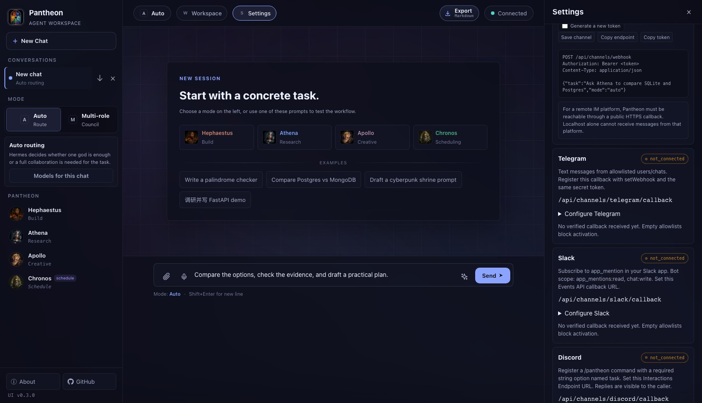

# Telegram, Slack and Discord

Adapters start disconnected. Keep `pantheon web` or the background service running. Verified callbacks invoke the shared Hermes runtime, budgets and task archives. Configured credentials do not prove a working connection; `receiving` appears only after an accepted callback.

## Prerequisites

Platforms cannot reach localhost. Provide a public HTTPS reverse proxy to Pantheon; expose only the three `/api/channels/<platform>/callback` paths where possible and keep administration local. If the public Host is forwarded, set `PANTHEON_ALLOWED_HOSTS=your-domain` in the process environment before startup. Remote binding also requires Security login. Callback authentication is platform-specific; configuration remains protected by UI login.

Explicit user and chat/channel ID allowlists are required to enable an adapter. Empty lists block activation. Saving credentials sends no messages. Replies occur only when enabled for allowed incoming tasks. Pantheon does not provision domains, certificates or public hosting.

## Telegram

1. Create a bot with official `@BotFather` and obtain its token.
2. Message the bot; before registering a webhook, inspect `getUpdates` for `message.from.id` and `message.chat.id`. Use numeric IDs, including a minus sign for group chats where applicable.
3. In Settings → Integrations → Channels → Telegram, enter user/chat IDs, bot token and your own callback secret (letters, digits, underscore/hyphen). Select credential storage and enable/save.
4. Register the public callback with `setWebhook` and the same secret:

   ```sh
   curl -X POST 'https://api.telegram.org/bot<BOT_TOKEN>/setWebhook' \
     -H 'Content-Type: application/json' \
     -d '{"url":"https://<DOMAIN>/api/channels/telegram/callback","secret_token":"<SAME_SECRET>"}'
   ```

5. Send a task from an allowed user/chat. Check event status and Task history; optional replies reference the original message.

Only text messages are accepted. Bot/file messages are ignored. The secret header must match and repeated update IDs do not execute twice. See [Telegram API](https://core.telegram.org/bots/api#setwebhook).

## Slack

1. Create an app with Bot scopes `app_mentions:read`, `chat:write`, install it to your workspace and obtain the Bot token and Signing Secret.
2. Invite the bot to the target channel. Obtain team (`T...`), user (`U...`) and channel IDs from Slack; display names are not IDs.
3. Save those IDs/credentials and enable Slack in Channels.
4. Set Event Subscriptions URL to `https://<DOMAIN>/api/channels/slack/callback`, complete signed URL verification, and subscribe to Bot `app_mention`. Reinstall when scope changes require it.
5. Mention the bot with a task in an allowed channel. Optional responses return in the original thread.

Raw-body signatures and fresh timestamps are required, followed by team/user/channel checks. Bot/edited messages are ignored and event retries are deduplicated. Ordinary messages, DMs and platform files are not supported by this release. See [signature verification](https://docs.slack.dev/authentication/verifying-requests-from-slack/) and [Events API](https://docs.slack.dev/apis/events-api/).

## Discord

1. Create an application and obtain Application ID and the 64-character hex Public Key. Install it to the target server with `applications.commands` authorization.
2. Enable Developer Mode and copy allowed user/channel IDs.
3. Save those IDs and Public Key in Channels and enable the adapter. Pantheon does not require a stored Discord bot token for interactions.
4. Set Interactions Endpoint URL to `https://<DOMAIN>/api/channels/discord/callback`; signed PING is verified and acknowledged.
5. Register `/pantheon` with a required string option named `task` using Discord's Commands API:

   ```sh
   curl -X POST 'https://discord.com/api/v10/applications/<APPLICATION_ID>/commands' \
     -H 'Authorization: Bot <YOUR_BOT_TOKEN>' \
     -H 'Content-Type: application/json' \
     -d '{"name":"pantheon","description":"Run a Pantheon task","options":[{"name":"task","description":"What should Pantheon do?","type":3,"required":true}]}'
   ```

6. Run `/pantheon task:<request>` from an allowed user/channel. Acknowledge/defer happens immediately, with the result private to the caller when replies are enabled. Expired interactions are not executed.

The adapter does not listen to all server messages or forward files. It validates Ed25519 signatures, application/user/channel IDs and suppresses reply mentions. See [interaction verification](https://github.com/discord/discord-api-docs/blob/main/developers/interactions/overview.mdx) and [responses](https://docs.discord.com/developers/interactions/receiving-and-responding).

## Delivery and limits

Statuses distinguish queued/running, processed without a reply, delivered, reply_failed, failed/interrupted/cancelled/expired. A reply timeout may follow successful delivery, so it is never retried automatically. Consult Task history for task success, complete results and recovery; delivery success is separate.

Limits are 10 tasks per user/minute and 100 pending tasks. Each incoming request is a separate text task; this release has no per-platform conversational transcript. Interactive MCP approvals cannot be granted through platform callbacks. Replies are shortened to platform limits and full artifacts remain local. Stopped Web/service cannot receive/process callbacks.

Credentials use `.env` or supported system storage and are never echoed in configuration responses. Logs redact URL tokens. Backups remove temporary reply tokens; restore disables adapters and prevents queued message replay.

Use `pantheon channels` to inspect state. `pantheon channels --platform telegram --config channel.json` accepts `config`, `secrets` and `storage` fields; the same API is available as `p.services.channels`. Keep credential-containing files out of Git.


Current channel settings, disconnected:


