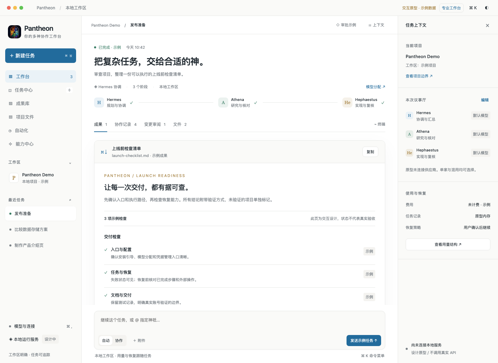
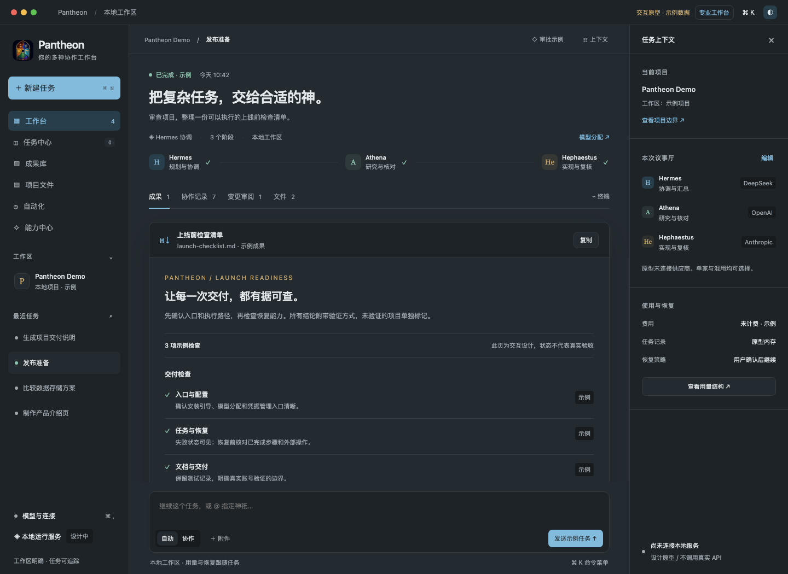
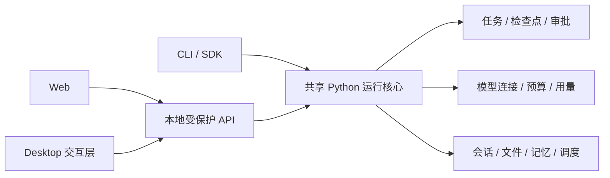

# Pantheon Desktop：交互设计

这是第二稿可操作的桌面交互原型，尚不是安装包。完整定位、参考取舍、Web/桌面能力对照与分期验收见[产品方向与能力规划](product-direction.zh-CN.md)。打开 `index.html` 可体验；预览图与 `verification.json` 记录了本轮视觉和交互检查。原型不连接任何 API，不读取本机项目，不执行命令，也不接收凭据。

## 设计方向

桌面端以“项目中的任务与成果”为中心。现有 Web 继续作为随开随用的聊天/工作区入口，CLI 保留终端任务和连续会话；三者共用核心能力和数据规则。

- 左侧是工作区、任务和自动化，不把神祇头像列表当作主导航。
- 中间是任务工作台：目标、协作阶段、成果、协作记录和文件。对话是继续推动任务的入口，交付物有独立展示位置。
- 右侧是可收起的上下文检查器：当前目录边界、参与角色、模型分配、用量与恢复。模型详情按需展开，避免到处重复版本号。
- 浅色采用纸面与蓝色操作强调，深色为石墨灰。当前标题栏以 macOS 演示，Windows/Linux 封装时采用各自系统的窗口控件。保留 Pantheon 标志与角色色彩，不复制当前 Web 的渐变网格布局。
- 终端是底部抽屉；工具审批是明确的独立步骤，显示目录、命令、作用范围和单次授权选项。

## 可以体验的交互

新建示例任务；任务中心最多两个模拟任务同时运行并分别停止；成果库按类型筛选和回到来源任务；成果/协作记录/变更审阅/文件切换；接受或退回示例变更；单家或按角色混用供应商；审批拒绝/允许一次；能力中心；专注/专业布局；终端布局；上下文收起；深浅主题；Cmd/Ctrl+K 命令菜单、Cmd/Ctrl+N 新任务和内容页签方向键。任务草稿、协作模式和模型分配分别保留在各自的示例任务中。

所有进度、费用和任务状态均标为示例。模型选择只改变原型内存，不代表供应商已连接；终端输出来自固定示例，不执行 shell。模拟结果不写入真实 Pantheon 会话。

## 共享核心边界

桌面端不复制路由、模型校验、预算、凭据、任务恢复或聊天平台逻辑。优先沿用 v0.4.0 已验收的结果协议、增量事件、模型覆盖、用量和连接生命周期。

### 启动、退出与工作区

1. 显式选择工作区，使用现有 DataPaths 和单实例租约。禁止重复启动同一工作区的调度服务。
2. 连接已有本地后台前核对实例归属、版本、工作区和认证；不能因为端口可访问就把它视为自己的后端。
3. 由桌面启动的后台与用户已有 Web 后台分别记录归属。退出时只管理自己拥有的进程；复用的用户服务不能静默停止。
4. “关闭窗口”和“退出服务”是不同操作。进行中的任务、未决工具审批和启用的自动化必须有清楚的退出行为；默认不因重连而重发任务。
5. 睡眠、网络断开、后台崩溃后先查持久任务结果，显示状态未知或可恢复，遵循现有的人工恢复边界。
6. 项目目录、工具权限和文件预览仍受核心边界约束；切换目录不扩大已有授权。

### 会话、模型与费用

Web/桌面可使用同一版本化会话数据协议，分别保存导航与窗口偏好。CLI 连续会话保持显式 ID 和单独记录。新会话默认模型与当前会话覆盖延续现有隔离规则。

单家模型是完整可用的首选路径，混用属于可选分配方式。用量按任务/角色/阶段查看；没有 token 或单价就显示未知，不把估算写成账单。凭据由核心现有的系统存储/私有 `.env` 管理，不进入客户端日志、原型或设计文件。

## 下一步实现顺序

| 顺序 | 交付 | 验收要求 |
| --- | --- | --- |
| 1 | 最小桌面壳与后台接入样机 | 三系统启动/退出、显式工作区、认证、单实例与版本核对 |
| 2 | 任务与会话贯通 | 正确增量输出、断流追查、恢复、模型隔离与完整记录 |
| 3 | 文件、终端与工具审批 | 工作区边界、审批范围、原生 Windows 终端 |
| 4 | 原生窗口能力 | 菜单、快捷键、通知、深浅主题与窗口状态 |
| 5 | 安装与更新 | Python 核心/依赖随包、签名、升级备份、失败回退 |

桌面封装框架在最小跨平台样机验收后确定。这个原型先固定交互和共享核心边界，不把浏览器演示称为桌面软件，也不假定用户已经安装开发环境。

## 本轮验证

安装开发用 Playwright/Chromium 后，可在项目根目录执行 `python docs/desktop/verify.py` 重跑交互检查并生成预览图。脚本只启动临时回环静态服务器，结束时自动关闭。

Chromium 检查了深浅主题、品牌资源、单家/混用分配及任务隔离、任务中心并行模拟与分别停止、成果筛选、变更审阅、专注/专业布局、能力中心、审批拒绝、新建/停止、文件/协作页签、终端演示与键盘菜单；1440、1024、760 宽度无页面横向溢出。运行时无 JavaScript 错误，只有静态资源请求，API 请求为 0。任务中心预览见 `preview-tasks.png`。原型未连接真实核心，进程管理、打包、系统权限和真实账户均未据此标记为通过。
