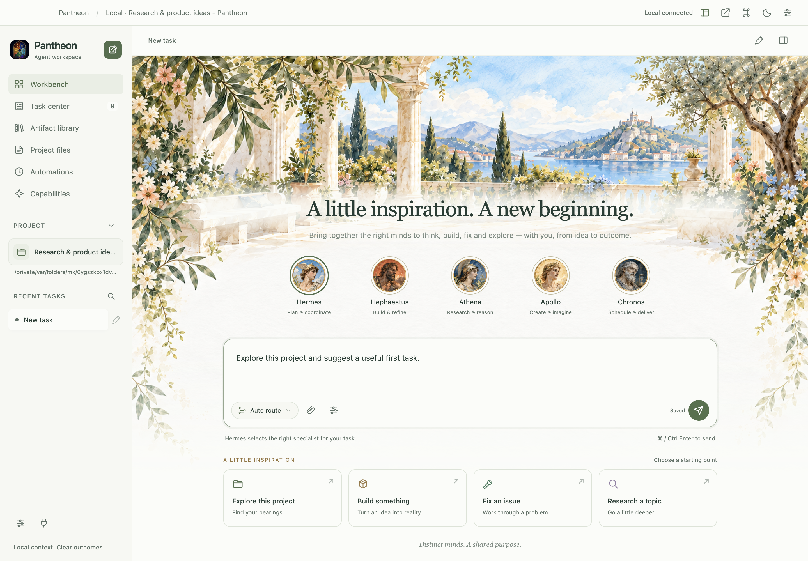
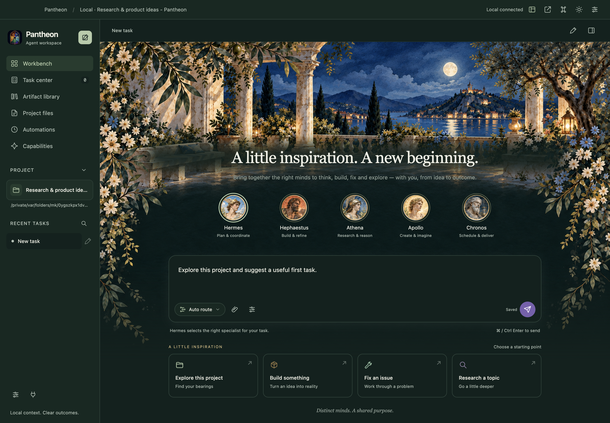
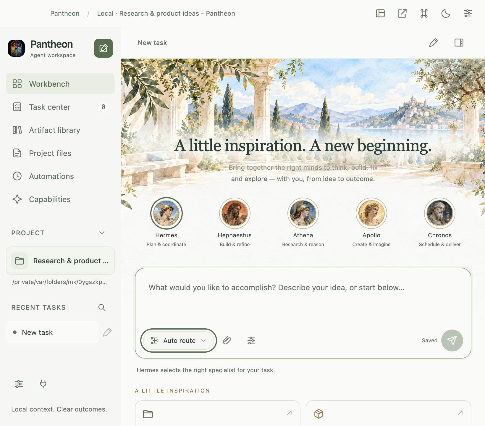

# Botanical watercolor themes

The desktop beta uses the selected **full-floral botanical watercolor** and **moonlit garden** directions. The simplified concept variants are not selectable themes. The interface remains English, with an ivory/sage light palette and a deep blue-green dark palette. The light send button is green (`#52724b`); the dark send button is purple (`#7960af`).

## Assets and implementation

| Local asset | Source and purpose |
| --- | --- |
| [`garden-day.png`](../../pantheon/desktop/static/garden-day.png) | Generated daytime background from the selected floral concept. Contains only watercolor scenery, with an empty center/lower canvas. |
| [`garden-night.png`](../../pantheon/desktop/static/garden-night.png) | Generated night edit of the daytime asset, using the selected moonlit concept as the lighting reference. |
| [`council-watercolor.png`](../../pantheon/desktop/static/council-watercolor.png) | Previously generated, selected light concept used only as a local portrait sheet. Live SVG viewports display the five circular painted faces. Its interface lettering and controls are outside the cropped regions. |
| [`botanical.css`](../../pantheon/desktop/static/botanical.css) | Theme colors, garden layering, readable title backdrop, responsive layout and send-button states. |

The two background edits were generated with Codex's built-in image-generation tool on 2026-10-23 (Asia/Singapore). No user API key was used. The tool did not report a model identifier, so this record does not infer one. The source references were the previously selected Pantheon concepts, rather than third-party UI screenshots.

Text, buttons, role selection, starter cards, composer, menus and sidebars are live HTML/SVG elements, not a flattened mockup. Portraits are 60 CSS pixels at the main window size and scale down in smaller windows. The decorative backgrounds are hidden from accessibility tools and cannot intercept input. They are bundled locally; there are no remote fonts or artwork requests. The garden remains visible in running/completed tasks and across Conversation, Result, Activity and Changes, around a compact task header and solid reading surfaces for legibility. Council details and task context open on demand; the full floral introduction remains on new tasks. It survives task reopen, reload and Focus layout. Project files and other utility pages retain their dedicated surfaces. Theme preference and unsent drafts survive reload.

The portrait viewports in the 1586 × 992 source sheet are `[x, y, width, height]`: Hermes `[364,505,151,151]`, Hephaestus `[593,505,151,151]`, Athena `[821,505,151,151]`, Apollo `[1055,505,151,151]`, Chronos `[1294,505,151,151]`. They share one decoded local asset.

## Generation prompts

### Day garden

Reference: selected full-floral botanical watercolor concept.

```text
Create a production BACKGROUND ART ASSET from the attached approved botanical watercolor Pantheon concept. Output ONLY the watercolor illustration with absolutely no UI, text, letters, logos, portraits, medallions, cards, buttons, toolbar, sidebar, window controls or paper-plane symbol. Remove every interface element and fill its area with the illustration or clean paper. Wide landscape 16:10 canvas. Keep the beautiful sunny Mediterranean stone colonnade and terrace, blue lake and distant hillside village, olive foliage, small ivory flowers and pastel blossoms framing the upper corners. THIS IS THE FULL FLORAL VERSION: retain a lush painterly garden, not the stripped minimal version. Arrange the detailed garden/architecture/scenery in the upper 35–40% of the image, with narrow graceful trailing flower-and-leaf framing at the extreme left and right edges. The lower central 60% and central 80% width must fade into uncluttered nearly white warm ivory paper (#fafbf7), providing a broad empty area for live application controls to be layered later. No objects, flowers or marks in that central lower area. Gentle translucent watercolor pigment and fine paper texture. The floral edges feather naturally into the light paper, no rectangular frames. No text anywhere, no humans or gods, no interface remnants. Preserve the reference's sophisticated art style, airy warm daylight and sage/blue/ivory palette.
```

### Moonlit garden

References: generated day garden as the edit target, selected moonlit concept as the color/lighting reference.

```text
Image 1 is the exact BACKGROUND ART EDIT TARGET, the production watercolor garden with an empty lower canvas. Image 2 is ONLY a night-lighting and color reference. Create the DARK moonlit counterpart of image 1. Preserve image 1's full landscape composition, colonnade, terrace, lake and distant village, lush floral upper corners and narrow trailing botanical side edges, and especially its broad completely empty central/lower area. Transform the art to a blue-hour moonlit garden: deep indigo sky with one soft full moon, cool lake reflections, a few warm amber village lights and subtle lanterns illuminating the stone and ivory blossoms. Match image 2's lovely dark botanical watercolor mood. The empty central/lower 60% must be an even very dark desaturated blue-green paper color, approximately #10211e, with only a whisper of watercolor texture. Keep all flowers at the upper garden and thin extreme side edges, away from the broad central lower area. Absolutely no UI, text, symbols, logos, portraits, medallions, cards, buttons, sidebar or interface remnants. This is only a background asset to be layered behind real application controls. Same landscape aspect ratio and framing as image 1. No neon and no magical effects; elegant readable night colors, distinct architectural details.
```

## Native screenshots

These screenshots come from the packaged application's isolated native test, using a localhost provider fixture. They establish the actual rendered layout; they do not establish commercial-provider account access.






