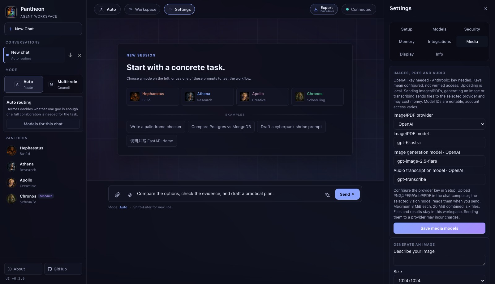

# Media, workflow and task recovery

Finish [installation](setup.md), then save a chat provider in Settings → Setup. Workspace settings are shared by Web, CLI and SDK; model overrides in one conversation do not change other chats or global defaults.

## Images and PDFs

1. Save OpenAI or Anthropic credentials in Setup, even if your ordinary chat provider is DeepSeek.
2. Open Settings → Media, select the vision provider and a model with image/PDF support, then Save media models. Configuration does not prove account access.
3. Attach PNG/JPEG/WebP/PDF in the composer: 8 MiB per file, 20 MiB combined, up to six files. File signatures must match their extensions.
4. Write a question and send. Uploading only saves locally; sending invokes the vision provider and passes its interpretation into the task.
5. Missing credentials, unsupported inputs, unavailable models and exceeded budgets produce an error; file metadata is never presented as successfully read content.

Private UUID artifacts live in the workspace state's `media/` directory. Conversations store IDs/metadata, not base64. Successful interpretation is checkpointed and reused on task resume.

```sh
pantheon ask --file report.pdf --file chart.png "Compare the evidence"
```

```python
from pathlib import Path
from pantheon import Pantheon
p = Pantheon()
result = p.ask("Explain this chart", attachments=[Path("chart.png")])
```

## Image generation and transcription

Configure the OpenAI image/audio model IDs in Media. Defaults reflect official documentation checked for this release; IDs remain editable and access depends on the account.

Generate creates one PNG with preview/download. Apollo can also invoke native generation when explicitly asked for an actual image. Transcribe accepts WAV/MP3/M4A/MP4/WebM up to 24 MiB. Download the result or prepare it in the composer for review; transcription does not automatically send a chat.

These are paid provider requests. DeepSeek credentials are never reused for OpenAI. Audio/video generation and image editing are not bundled.

```sh
pantheon image "A blue glass temple under the stars"
pantheon transcribe recording.wav
pantheon media
```

```python
artifact = p.services.media.generate_image("A blue glass temple under the stars")
metadata, image_path = p.services.media.get(artifact["id"])
audio = p.services.media.upload_path("recording.wav")
transcript = p.services.media.transcribe(audio["id"])
```

## Parallel execution and bounded recovery

Settings → Info → Workflow controls independent workers (1–4, default 3) and recovery rounds (0–2, default 1). Only dependency-ready safe steps overlap; unrelated step context stays isolated. Scheduling, image generation and roles with write/approval tools run exclusively.

Recovery repairs failed instructions in the existing plan, retains successes and cannot change roles/dependencies or expand scope. Key/quota/approval errors and unfinished external operations are not automatically replayed.

```sh
pantheon workflow --parallel 3 --recovery 1
```

## Budgets

Info → Budgets controls task/24-hour attempts, output tokens and local cost estimates. Zero disables a limit. Planning, synthesis, recovery, media and failed attempts count; concurrent requests reserve capacity atomically.

Token prices use your input/output USD rates per million tokens. Media uses your conservative USD estimate per request rather than counting base64 as text tokens. A USD cap blocks unpriced models before sending. Failed/unmetered calls retain reservations; estimates are not provider invoices.

Save a JSON policy with `pantheon budgets --policy policy.json`. Prices are keyed by `provider/model-id`: `prices` values contain `input`/`output` rates, while `operation_prices` values are USD per media request. Request limits can be used without price estimates.

## Resume and archives

Use Info → Task history → Resume failed steps / Download full archive, or:

```sh
pantheon tasks
pantheon tasks --show TASK_ID
pantheon tasks --resume TASK_ID
pantheon tasks --archive TASK_ID > result.json
```

Resume uses saved defaults and the original plan; successful checkpoints are reused. Review unfinished external operations before acknowledging a retry in Web or with `--acknowledge-effects`. Continue the child task instead of retrying an already resumed parent twice. Older tasks without checkpoints must start a new request.

Task details may show a marked 200,000-character excerpt; full JSON archives are not truncated. Stop prevents subsequent calls, but an accepted synchronous provider request can still finish and be billed.

Offline backups include uploaded/generated media. Restore disables chat callbacks and marks queued events interrupted, preventing automatic message replay. It merges saved files without deleting files absent from the backup.


Current Media page, without configured keys or a claimed successful generation:


